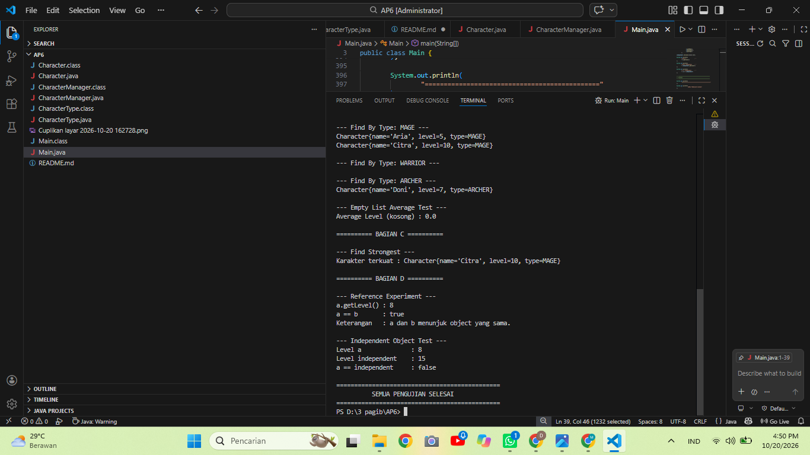

## Bagian C — Fitur Analitik Rancangan Sendiri

Fitur analitik yang saya rancang adalah `findStrongest()`. Method ini digunakan untuk mencari karakter yang mempunyai level paling tinggi dari seluruh karakter yang tersimpan di `CharacterManager`.

Method bekerja dengan mengambil karakter pertama sebagai karakter terkuat sementara, kemudian membandingkan level setiap karakter berikutnya. Jika ditemukan karakter dengan level yang lebih tinggi, karakter tersebut menjadi karakter terkuat sementara. Setelah semua karakter diperiksa, method mengembalikan karakter dengan level tertinggi.

Fitur ini menjaga encapsulation karena tidak mengembalikan `ArrayList` internal milik `CharacterManager`. Method hanya mengembalikan satu object `Character` sebagai hasil pencarian. Jika tidak ada karakter, method mengembalikan `null`.

Method juga dilengkapi Javadoc singkat yang menjelaskan fungsi method dan nilai yang dikembalikan.

Saya memilih `findStrongest()` karena fitur ini memberikan informasi analitik tambahan yang berguna. Selain dapat menambah, mencari, dan menghapus karakter, `CharacterManager` juga dapat digunakan untuk mengetahui karakter dengan level paling tinggi.

### Pengujian

Method `findStrongest()` diuji melalui `Main.java`. Berdasarkan data karakter yang digunakan, Citra memiliki level paling tinggi, yaitu level 10.

Contoh output:

PS D:\3 pagib\AP6> javac *.java
PS D:\3 pagib\AP6> java Main
==============================================
       CHARACTER MANAGER - TP5
       AP6 BELAJAR PRAKTIK
==============================================

========== BAGIAN A ==========

--- Add Character ---
Tambah Aria  : true
Tambah Bima  : true
Tambah Citra : true
Tambah Doni  : true

--- Duplicate Name Test ---
Tambah Aria lagi : false
Total Character  : 4

--- Find By Name ---
Karakter ditemukan : Character{name='Bima', level=8, type=WARRIOR}

--- Get All Characters ---
Character{name='Aria', level=5, type=MAGE}
Character{name='Bima', level=8, type=WARRIOR}
Character{name='Citra', level=10, type=MAGE}
Character{name='Doni', level=7, type=ARCHER}

--- Total Characters ---
Jumlah karakter : 4

--- getAllCharacters() Copy Test ---
Jumlah data sebelum copy.clear() : 4
Jumlah data pada copy setelah clear : 0
Jumlah data pada manager           : 4
Data manager tetap ada : [Character{name='Aria', level=5, type=MAGE}, Character{name='Bima', level=8, type=WARRIOR}, Character{name='Citra', level=10, type=MAGE}, Character{name='Doni', level=7, type=ARCHER}]

--- Remove Character ---
Bima berhasil dihapus : true
Total Character setelah remove : 3

========== BAGIAN B ==========

--- Average Level ---
Rata-rata level : 7.333333333333333

--- Find By Type: MAGE ---
Character{name='Aria', level=5, type=MAGE}
Character{name='Citra', level=10, type=MAGE}

--- Find By Type: WARRIOR ---

--- Find By Type: ARCHER ---
Character{name='Doni', level=7, type=ARCHER}

--- Empty List Average Test ---
Average Level (kosong) : 0.0

========== BAGIAN C ==========

--- Find Strongest ---
Karakter terkuat : Character{name='Citra', level=10, type=MAGE}

========== BAGIAN D ==========

--- Reference Experiment ---
a.getLevel() : 8
a == b       : true
Keterangan   : a dan b menunjuk object yang sama.

--- Independent Object Test ---
Level a              : 8
Level independent    : 15
a == independent     : false

==============================================
          SEMUA PENGUJIAN SELESAI
==============================================
PS D:\3 pagib\AP6> 

Bagian D : https://drive.google.com/file/d/1ZqbtSfimXZ4Mg_XclHvBW76k4OsIUgr-/view?usp=drivesdk

